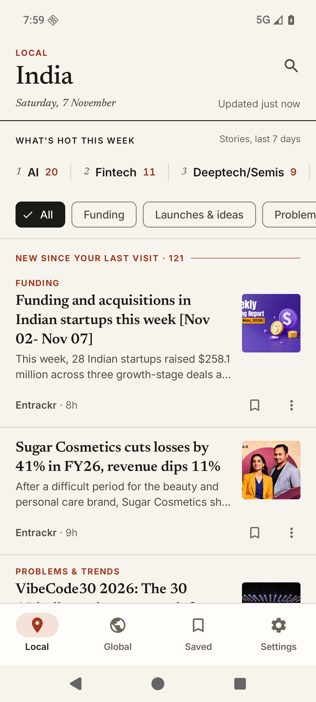
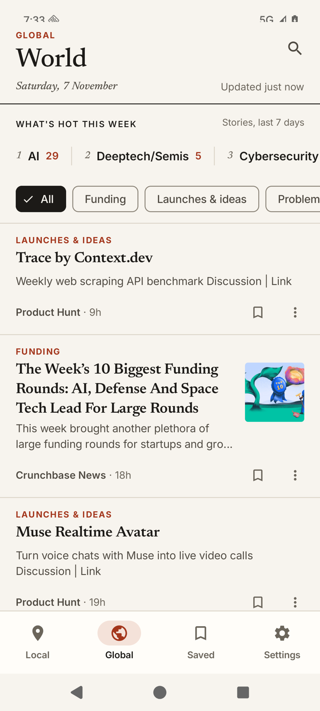
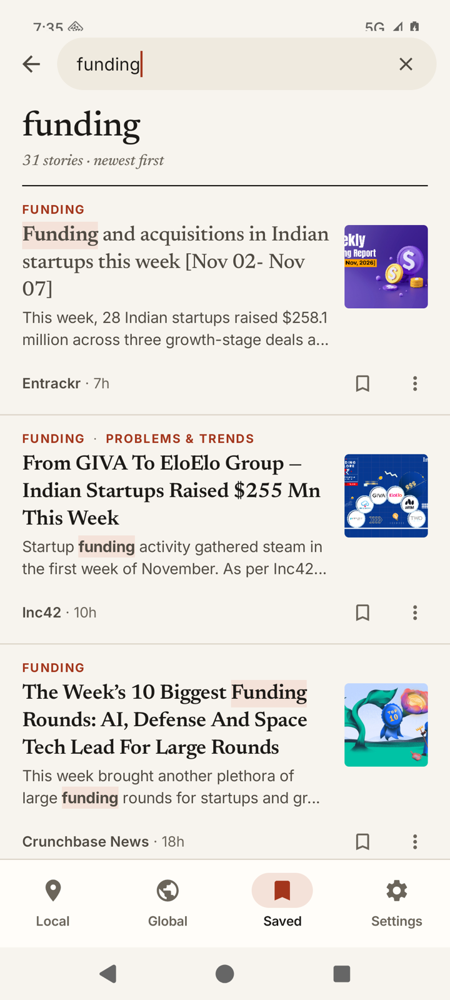
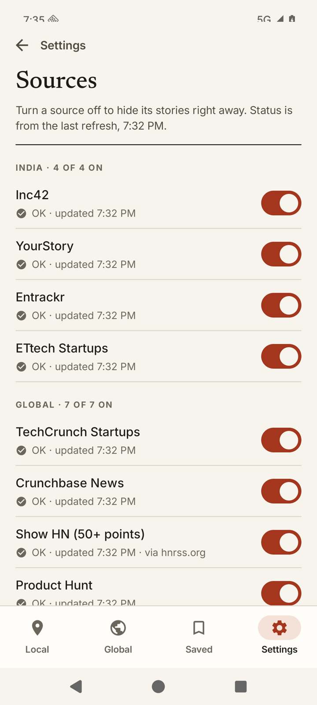
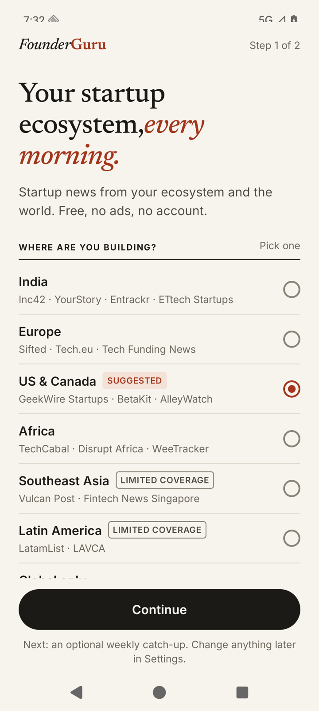

# FounderGuru

**Startup news from your region and the world, sorted for founders.** A free, open-source Android reader for aspiring and early-stage founders.

No ads, no account, no tracking, no backend. Stories are **linked, not copied**: the app shows a headline, a short snippet and the publisher's name, and every story opens on the publisher's own site. Free software under GPL-3.0-or-later.

<p>
  
  
  
  
  
  
</p>

## What and why

Founders outside Silicon Valley piece their news together from US-centric sites, paywalled regional publishers and ad-heavy apps. FounderGuru reads 24 trusted startup feeds **on your phone** and shows them in two tabs:

- **Local**: your ecosystem (India, Europe, North America, Southeast Asia, Africa or Latin America), with a few global stories that mention your region mixed in and marked "Via Global".
- **Global**: worldwide startup news, launches and founder playbooks.

Then it helps you scan:

- **Founder lenses**: Funding · Launches & ideas · Problems & trends · Playbooks. Open keyword rules, run on the device and measured in CI against hand-labelled stories (precision at least 0.75 per lens).
- **What's hot this week**: the sectors with the most stories in the last 7 days.
- **New since your last visit**, an optional weekly or daily **digest** notification, **Saved** stories, **Share** and offline **Search**.
- Light and dark themes, TalkBack labels, 48 dp touch targets and layouts that hold up at 200% text.

## Install

| Where | Status |
|---|---|
| F-Droid | Submitted, waiting for F-Droid review |
| [GitHub Releases](https://github.com/ukpratik/founderguru/releases) | 1.0.0: signed APK |

Android 8.0 (API 26) or newer.

## Sources

Every story credits its publisher and links to the publisher's page. FounderGuru only reads each publisher's public RSS or Atom feed and stores the headline, up to 200 characters of the summary, the image URL the feed gives, the publisher's name and the time. Content belongs to the publishers. Any source can be switched off in Settings › Sources.

| Region | Publisher | Feed host | Notes |
|---|---|---|---|
| Global | [TechCrunch Startups](https://techcrunch.com) | `techcrunch.com` |  |
| Global | [Crunchbase News](https://news.crunchbase.com) | `news.crunchbase.com` |  |
| Global | [Show HN (50+ points)](https://news.ycombinator.com/show) | `hnrss.org` | via hnrss.org (third-party proxy) |
| Global | [Product Hunt](https://www.producthunt.com) | `www.producthunt.com` | at most 5 a day |
| Global | [Y Combinator Blog](https://www.ycombinator.com/blog) | `www.ycombinator.com` |  |
| Global | [First Round Review](https://review.firstround.com) | `review.firstround.com` |  |
| Global | [Rest of World](https://restofworld.org) | `restofworld.org` |  |
| India | [Inc42](https://inc42.com) | `inc42.com` |  |
| India | [YourStory](https://yourstory.com) | `yourstory.com` | startup keyword filter |
| India | [Entrackr](https://entrackr.com) | `entrackr.com` |  |
| India | [ETtech Startups](https://economictimes.indiatimes.com/tech/startups) | `economictimes.indiatimes.com` | startup keyword filter |
| Europe | [Sifted](https://sifted.eu) | `sifted.eu` |  |
| Europe | [Tech.eu](https://tech.eu) | `tech.eu` |  |
| Europe | [Tech Funding News](https://techfundingnews.com) | `techfundingnews.com` |  |
| North America | [GeekWire Startups](https://www.geekwire.com/startups) | `www.geekwire.com` |  |
| North America | [BetaKit](https://betakit.com) | `betakit.com` |  |
| North America | [AlleyWatch](https://www.alleywatch.com) | `www.alleywatch.com` |  |
| Southeast Asia | [Vulcan Post](https://vulcanpost.com) | `vulcanpost.com` | startup keyword filter |
| Southeast Asia | [Fintech News Singapore](https://fintechnews.sg) | `fintechnews.sg` |  |
| Africa | [TechCabal](https://techcabal.com) | `techcabal.com` | startup keyword filter |
| Africa | [Disrupt Africa](https://disruptafrica.com) | `disruptafrica.com` |  |
| Africa | [WeeTracker](https://weetracker.com) | `weetracker.com` |  |
| Latin America | [LatamList](https://latamlist.com) | `latamlist.com` |  |
| Latin America | [LAVCA](https://www.lavca.org) | `www.lavca.org` |  |
"Startup keyword filter" means only items that mention startup words (funding, launch, founder, startup and so on) are kept, because these publishers also cover general business or lifestyle topics. The list lives in [`app/src/main/assets/sources.json`](app/src/main/assets/sources.json); a weekly GitHub Actions job checks every feed and opens an issue when one breaks.

**Suggest a source:** open an issue at <https://github.com/ukpratik/founderguru/issues> with the publisher, its feed URL and the region. A good source is mostly startup or VC news, has a free full RSS/Atom feed over HTTPS, publishes at least weekly, and allows reading its feed (no Cloudflare challenge for apps).

## Privacy

There is no FounderGuru server. The app talks only to the publishers' feed hosts listed above, to `hnrss.org` (a third-party proxy for the Show HN feed) and to the image hosts named in the feeds; those hosts see your IP address, as with any browser. There are no ads, analytics, crash reports or accounts. Your region, saved stories, searches and settings stay on your phone. Permissions: internet, network state, notifications (asked for only when you turn the digest on), and the two WorkManager permissions for background refresh; CI fails the build if anything else appears. Full policy: [`PRIVACY.md`](PRIVACY.md).

## Build, run, test

Requirements: JDK 21 or newer (Gradle runs on it; CI uses Temurin 21) and the Android SDK with platform 37. Point Gradle at the SDK with `ANDROID_HOME` or a git-ignored `local.properties` (`sdk.dir=/path/to/Android/sdk`).

```bash
./gradlew installDebug              # debug build on a connected device (io.github.ukpratik.founderguru.debug)
./gradlew assembleRelease           # what F-Droid builds: R8, unsigned without signing properties
./gradlew test                      # unit tests: :core and :tools:feedcheck on the JVM, :app on Robolectric
scripts/ci.sh                       # every CI gate, exactly as GitHub Actions runs it
./gradlew :tools:feedcheck:run --args="app/src/main/assets/sources.json build/feedcheck.json --attempts 1"   # check every live feed
./gradlew :core:test --tests '*LiveFeedsTest' -Pfg.live=true   # the live feeds through the app's own pipeline
```

`scripts/ci.sh` runs the unit tests (including the lens precision gate on two hand-labelled sets and golden tests for What's hot), the Room schema drift check, Android Lint with warnings as errors, the R8 release build with the AboutLibraries strict licence gate, the permission allowlist, a check for Google proprietary classes and the APK size gate (under 10 MB).

Release builds are unsigned unless `founderguru.release.*` signing properties exist in `~/.gradle/gradle.properties`. Keys and passwords never go in this repository.

## Project layout

```
core/                pure Kotlin: fetch, clean, parse, normalise, lens/sector tagging, blending, digest timing (no Android)
app/                 Android app (Jetpack Compose, Material 3, Room, DataStore, WorkManager, Coil)
tools/feedcheck/     JVM CLI used by the weekly feed-health workflow
build-logic/         Gradle convention plugins
scripts/             ci.sh and its gates, feed-health-issues.sh, subset-fonts.sh
fastlane/            store listing texts, changelogs and images (used by F-Droid)
```

## Contributing

Bug reports, source suggestions and pull requests are welcome; see [`CONTRIBUTING.md`](CONTRIBUTING.md). The short version: FOSS dependencies only, no tracking, tests with the code, and `scripts/ci.sh` green.

## Licence

GNU General Public License v3.0 or later. See [`LICENSE`](LICENSE). Bundled fonts (Newsreader, Inter) are under the SIL Open Font License 1.1 and the icons are Material Symbols (Apache-2.0); every library is listed in the app under Settings › About › Open-source licences. Headlines, snippets and images belong to their publishers.
